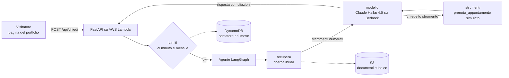

# Lumen v2 — assistente RAG in Python, LangChain e LangGraph su AWS

Assistente virtuale della segreteria dello **Studio Dentistico Lumen**, uno studio **fittizio** creato per una demo:
nomi, indirizzo, telefono e prezzi sono inventati.
Risponde solo usando i documenti dello studio, cita la fonte di ogni informazione e dice "non lo so" quando l'informazione manca.

È la versione 2 dell'assistente pubblicato a ottobre 2026 nel mio portfolio ([websolution-progetti.pages.dev](https://websolution-progetti.pages.dev)).
Stessi 9 documenti e stesse regole, rifatto con lo stack che usano le aziende.

> Progetto personale sviluppato con assistenza AI (Claude).

*English: a retrieval-augmented assistant for a fictitious dental clinic. Python, LangChain, LangGraph agent with a simulated booking tool, hybrid search (Titan embeddings + BM25), Claude Haiku on Amazon Bedrock, FastAPI on AWS Lambda.*

## Cosa fa

- **Risposte dai documenti, con citazioni**: ogni frase che usa un'informazione riporta il frammento [1], [2]…
- **"Non lo so"** quando i documenti non contengono la risposta, invece di inventare.
- **Niente consigli medici**: per sintomi e farmaci rimanda allo studio o al 112.
- **Dati personali oscurati** prima di arrivare al modello: email, telefono, codice fiscale, IBAN, carte, date di nascita.
- **Strumento di prenotazione simulata** (agente LangGraph): se l'utente chiede di prenotare, l'agente raccoglie
  tipo di visita, giorno e fascia oraria e registra una richiesta **finta** con un codice `DEMO-…`.
  Non chiede mai dati personali e non salva nulla.
- **Documenti di prova del visitatore**: si possono caricare fino a 3 testi, usati solo per quella domanda.
- **Italiano e inglese**.

## Come funziona



1. **Ricerca ibrida** (`app/ricerca.py`): embeddings **Amazon Titan Text v2** con ricerca per somiglianza (FAISS,
   o NumPy nel pacchetto Lambda) + **BM25** per le parole esatte, unite con la **Reciprocal Rank Fusion**.
   La v1 usava solo le parole chiave: la ricerca semantica trova anche "quanto si paga la pulizia?" → "Igiene professionale: 70 euro".
2. **Agente** (`app/agente.py`): grafo LangGraph `recupera → modello ⇄ strumenti`, con un massimo di 2 giri di strumenti.
3. **Modello** (`app/modelli.py`): Claude Haiku 4.5 tramite il profilo europeo di Bedrock (i dati restano in UE),
   con **Amazon Nova Lite** come riserva automatica se Claude non risponde.
4. **API** (`app/api.py`): FastAPI con documentazione automatica su `/docs`; stesso formato JSON della v1,
   così la pagina web cambia solo indirizzo. Su Lambda gira tramite l'adattatore Mangum.

## v1 e v2 a confronto

| | v1 (ottobre 2026) | v2 (questo progetto) |
| --- | --- | --- |
| Linguaggio | JavaScript (Cloudflare Worker) | Python |
| Orchestrazione | codice scritto a mano | LangChain + LangGraph (agente con strumenti) |
| Modello | Claude Haiku tramite API Anthropic | Claude Haiku 4.5 tramite Amazon Bedrock, riserva Amazon Nova |
| Ricerca | BM25 (parole chiave) | ibrida: embeddings Titan + BM25 |
| Hosting | Cloudflare Pages | AWS Lambda + S3 + DynamoDB |
| Azioni | nessuna | prenotazione simulata |
| Test | prove manuali | 42 test automatici, 30 domande sul modello vero, valutazione RAGAS |
| Osservabilità | nessuna | tracce LangSmith di ogni domanda, con i dati personali oscurati |

## Protezioni di spesa e sicurezza

- **Tetto mensile** di domande (300 di default) contato su DynamoDB: raggiunto il tetto la chat va in pausa
  e riparte da sola il mese dopo.
- **Limite per visitatore**: 8 domande al minuto.
- **Budget AWS** con avvisi email e blocco automatico di Bedrock oltre la soglia.
- **Permessi minimi**: la funzione può usare solo i tre modelli indicati, leggere il suo bucket e aggiornare il contatore.
- **Bucket S3 privato**; indice salvato come vettori `.npy` + JSON, senza `pickle`.
- **Difesa dalle istruzioni nascoste** (prompt injection): i documenti e i messaggi sono trattati come materiale
  da consultare, mai come istruzioni. È verificato dalla valutazione (`scripts/valuta.py`).
- Nessuna chiave nel codice: su Lambda le credenziali arrivano dal ruolo IAM.

## Provarlo in locale

Senza AWS (modello ed embeddings finti, gratis):

```bash
python -m venv .venv && source .venv/bin/activate      # su Windows: .venv\Scripts\activate
pip install -r requirements-dev.txt
LUMEN_MODALITA=finto python scripts/costruisci_indice.py
LUMEN_MODALITA=finto uvicorn app.api:app --reload
# apri http://127.0.0.1:8000/docs
```

Con Docker:

```bash
docker build -t lumen-v2 .
docker run -p 8000:8000 -e LUMEN_MODALITA=finto lumen-v2
```

## Test e valutazione

```bash
LUMEN_MODALITA=finto python -m pytest -q        # 42 test, senza AWS, in meno di un secondo
python scripts/valuta.py                        # 30 domande al modello vero (serve AWS, pochi centesimi)
```

La valutazione controlla fonti citate, "non lo so", rifiuto dei consigli medici, resistenza alle istruzioni
nascoste, oscuramento dei dati personali e uso corretto dello strumento. I test girano anche su GitHub Actions
a ogni modifica.

### Valutazione con RAGAS

Oltre ai controlli di comportamento, la qualità del RAG è misurata con [RAGAS](https://docs.ragas.io) su 12 domande
(9 in italiano, 3 in inglese) con risposta di riferimento copiata dai documenti. Il giudice è Claude Haiku su Bedrock.

Il 14/11/2026 ho riscritto le istruzioni dell'agente (risposte di 2-3 frasi, solo quello che è chiesto, recapiti
solo se richiesti o se l'informazione manca, con un esempio buono e uno da evitare) e ho confrontato le versioni
sulle stesse domande con `deploy/valuta_confronto.sh`:

| | 2026-11-13 | 2026-11-14 | **2026-11-14b (online)** |
| --- | --- | --- | --- |
| Domande di controllo superate | 28/29 | 28/29 | 29/30 |
| Lunghezza media delle risposte | 50 parole | 41 | 40 |
| Faithfulness (solo cose presenti nei frammenti) | 0,90 | 0,96 | **0,98** |
| Answer relevancy, giudice standard | 0,34 | 0,33 | 0,35 |
| Answer relevancy, giudice adattato all'italiano | 0,60 | 0,60 | 0,61 |
| Context precision / context recall | 0,81 / 1,00 | 0,81 / 1,00 | 0,81 / 1,00 |

Cosa ho imparato dal confronto:

- **La misura va controllata quanto il modello.** L'answer relevancy bassa non era colpa delle risposte: il giudice
  di RAGAS lavora in inglese e, partendo da risposte italiane, genera domande in inglese che si confrontano male con
  quelle vere (domande inglesi circa 0,55, italiane circa 0,29). Con le istruzioni del giudice adattate all'italiano
  (`scripts/ragas_pertinenza_it.py`, `adapt_prompts` di RAGAS) le italiane salgono a circa 0,60.
- **Una regola nuova può rompere un caso vecchio.** "Non proporre di prenotare" ha fatto rifiutare una prenotazione
  chiesta esplicitamente: corretto nella 2026-11-14b, e la valutazione lo ha mostrato subito.
- **"Ogni quanto devo fare l'igiene?" vale 0 con tutti i giudici**: RAGAS considera evasiva la frase "il dentista può
  indicare una frequenza diversa", che però è copiata dal documento. È un limite della metrica, non dell'agente.

La versione precedente delle istruzioni resta nel codice solo per le valutazioni (`LUMEN_PROMPT=2026-11-13`).

```bash
python scripts/ragas_dati.py                                   # risposte dell'agente vero (serve AWS)
python3 -m venv /tmp/ragas && /tmp/ragas/bin/pip install -r requirements-ragas.txt
/tmp/ragas/bin/python scripts/ragas_punteggi.py                # punteggi (qualche centesimo)
bash deploy/valuta_confronto.sh 2026-11-13 2026-11-14b         # confronto completo tra due versioni
```

### Tracce con LangSmith

Ogni domanda al sito diventa una traccia su [LangSmith](https://smith.langchain.com) (regione EU, piano gratuito):
i passi del grafo LangGraph, la chiamata a Claude con i frammenti passati, lo strumento usato, tempi e token.
Le valutazioni finiscono in un progetto separato con la versione delle istruzioni nei metadati, così si confrontano
le risposte una per una.

- Si accende solo con `LUMEN_LANGSMITH=1` e una chiave in `LANGSMITH_API_KEY` (`deploy/attiva_langsmith.sh`,
  che chiede la chiave senza mostrarla e la salva solo nelle impostazioni della Lambda).
- Prima dell'invio ogni testo ripassa nell'oscuramento dei dati personali (`app/tracciamento.py`): seconda rete
  di sicurezza oltre a quella prima del modello. Verificato sul sito vero: un'email nella domanda arriva come
  `[email oscurata]`.
- Se LangSmith è lento o irraggiungibile la risposta al visitatore non aspetta (timeout di 3 secondi, un solo
  nuovo tentativo); su Lambda le tracce partono prima che la funzione si congeli.

RAGAS 0.4 usa una versione precedente di LangChain, per questo gira in un ambiente separato.

## Pubblicazione su AWS

In AWS CloudShell, dalla cartella del progetto:

```bash
bash deploy/crea_risorse.sh      # crea bucket, indice, tabella, ruolo, funzione e indirizzo web
bash deploy/aggiorna_codice.sh   # aggiorna solo il codice della funzione (dopo aver caricato lumen-v2.zip)
bash deploy/ricostruisci_pacchetto.sh  # rifà lumen-v2.zip dal pacchetto già pubblicato + il codice di questa cartella
bash deploy/attiva_langsmith.sh  # accende le tracce LangSmith ("spegni" per toglierle)
bash deploy/elimina_risorse.sh   # cancella tutto
```

Regione: `eu-central-1` (Francoforte). Lambda, S3 e DynamoDB restano nelle quote gratuite;
Bedrock costa frazioni di centesimo a domanda.

## Struttura

```
app/
  api.py          FastAPI: /api/chiedi, /api/documenti, /api/salute
  agente.py       grafo LangGraph e formato della risposta
  ricerca.py      embeddings, indice, ricerca ibrida
  modelli.py      Claude su Bedrock con riserva Nova; modello finto per i test
  prompt.py       regole per il modello (versione attuale e precedente)
  tracciamento.py tracce LangSmith con i dati personali oscurati
  strumenti.py    prenota_appuntamento (simulato)
  privacy.py      oscuramento dei dati personali
  limiti.py       tetto mensile (DynamoDB) e limite al minuto
documenti/        i 9 documenti dello studio, in italiano e inglese
scripts/          costruzione dell'indice, valutazione, RAGAS e confronto tra versioni
deploy/           risorse AWS, aggiornamento del codice, LangSmith e confronto
tests/            test automatici
```

## Limiti noti

- Lo studio, i documenti e le prenotazioni sono finti: è una demo, non un servizio per pazienti.
- Il limite al minuto vive nella memoria di ogni istanza Lambda (come nella v1): basta per una demo,
  per un servizio vero andrebbe su DynamoDB o API Gateway.
- Nel pacchetto zip per Lambda FAISS non entra nel limite di 250 MB: lì la ricerca vettoriale usa NumPy,
  che con poche decine di frammenti dà gli stessi risultati. Con un'immagine container si userebbe FAISS.
- In inglese la richiesta "I'd like to book a first visit on Monday morning" a volte non usa lo strumento: il documento
  degli appuntamenti dice che la chat non può prenotare e l'agente gli dà ragione. In italiano prenota. È l'unica
  domanda di controllo su 30 che non passa con le istruzioni attuali.
